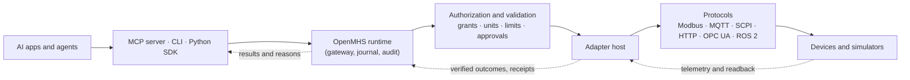

<h1 align="center">
<picture>
<source media="(prefers-color-scheme: dark)" srcset="docs/assets/openmhs-logo-dark.png">

</picture>
</h1>

<p align="center"><strong>Connect AI agents to programmable hardware.</strong></p>

<p align="center">
OpenMHS is an open-source gateway that sits between an AI agent and the instruments it wants to use. Every command is checked against a written contract and a deny-by-default policy, journaled, and verified by reading the device back.
</p>

<p align="center">
<a href="https://github.com/KNambiarDJsc/Open-MHS/actions/workflows/ci.yml"></a>
<a href="LICENSE"></a>


</p>

<p align="center">
<a href="https://openmhs.vercel.app">Website</a> ·
<a href="#quickstart">Quickstart</a> ·
<a href="docs/connect-a-device.md">Connect your device</a> ·
<a href="#documentation">Documentation</a> ·
<a href="docs/compatibility.md">Compatibility</a> ·
<a href="CONTRIBUTING.md">Contributing</a>
</p>

<p align="center">

</p>

<p align="center"><sub>Real output from simulated devices, no hardware. Plain text: <a href="docs/assets/demo-transcript.txt">demo-transcript.txt</a>.</sub></p>

> **Independent project.** OpenMHS is not affiliated with, endorsed by, or compatible with
> Anthropic or its Model Hardware Standard, whose specification is not public. Pre-alpha:
> **no adapter has been run against physical hardware by the project**, and OpenMHS is
> not a safety system. [Details below](#safety-and-known-limitations).

## Why OpenMHS

Letting a language model drive real equipment goes wrong in three predictable ways.

1. **Nothing says what a device accepts.** A model guesses at units, ranges and ordering,
   and a bare `5` can mean volts, millivolts or a mistake. OpenMHS describes each device
   in a [descriptor](spec/descriptor.md) with units, limits, preconditions and side
   effects, and refuses what does not fit it. Nothing is guessed.
2. **Permission lives in the prompt.** Telling a model "don't exceed 12 V" is a request.
   In OpenMHS a [deterministic policy](spec/authorization.md) decides, deny by default,
   with scoped credentials and human approval for hazardous actions. A model cannot
   grant itself access.
3. **Timeouts are ambiguous.** If a write goes unanswered, the device may or may not have
   changed. OpenMHS records it as `UNKNOWN_OUTCOME`, does not retry blindly, and
   [reconciles](spec/lifecycle.md) by reading the device. Every command is journaled
   and the audit log is hash-chained.

Real-time control stays in the device's own controller, and hardware safety systems keep
final authority.

## Quickstart

About a minute, with simulated devices only. You need a built `openmhs` binary; there is
no published release yet, so build from source (Rust 1.89+):

```sh
git clone https://github.com/KNambiarDJsc/Open-MHS
cd Open-MHS
cargo install --locked --path crates/openmhs-cli    # installs openmhs and openmhsd
openmhs --version
```

**1. See it work (about 10 seconds).** A guided run of a real gateway over its API:

```sh
openmhs demo
```

**2. Run the gateway yourself.** In terminal 1:

```sh
openmhs serve --sim
```

In terminal 2, as the operator, allow an agent to use the simulated power supply and
create its credential. The token is printed once.

```sh
openmhs devices list
openmhs grants add --id agent-psu --principal agent:demo --device sim.psu-01 --capability '*' --ops read,write --effect allow
openmhs tokens create agent:demo --any-scope
```

Then act as the agent. Unix shells:

```sh
export OPENMHS_TOKEN=omhs_...                     # the token printed above
openmhs exec sim.psu-01 power.output.voltage.setpoint --value 5V     # refused: jumps too fast
openmhs exec sim.psu-01 power.output.voltage.setpoint --value 2V     # applied and read back
```

PowerShell:

```powershell
$env:OPENMHS_TOKEN = "omhs_..."                   # the token printed above
openmhs exec sim.psu-01 power.output.voltage.setpoint --value 5V
openmhs exec sim.psu-01 power.output.voltage.setpoint --value 2V
```

The 5 V request ends `DENIED command.slew_exceeded: change of 5 V exceeds the limit of
2 V per 1000 ms`, and nothing is sent to the device. The 2 V request ends
`VERIFIED -> succeeded (confirmed by readback)`. Last, check that the audit log is
intact (as the operator, without the token):

```sh
openmhs audit verify
```

The simulated devices are `sim.thermo-01` (temperature sensor), `sim.psu-01` (power
supply) and `sim.axis-01` (linear stage). State resets when the gateway restarts.

**Your own device:** `openmhs profile new mqtt --id my.device-01` writes a starter profile
for a Modbus TCP, MQTT, SCPI or HTTP device, and [Connect your own device](docs/connect-a-device.md)
takes it from there to an agent, with each step tried against a simulator first.

## Features

- **Device contract.** [Descriptors](spec/descriptor.md) with units, ranges, rate and slew limits, preconditions, freshness and side-effect classes, checked against JSON Schemas.
- **Deterministic policy.** Deny by default, scoped credentials, operator and agent roles, single-use approvals, [layers of checks](spec/authorization.md) no model can talk its way past.
- **Honest lifecycle.** Idempotent commands, deadlines, [`UNKNOWN_OUTCOME`](spec/lifecycle.md), readback verification, reconciliation and crash recovery over a SQLite journal.
- **Audit.** A hash-chained, tamper-evident log of grants, reads, transitions and faults, verified with `openmhs audit verify`.
- **Three front doors.** A [CLI](docs/cli.md), an [MCP server](docs/mcp.md) for agents (stdio), and a [Python SDK](python/README.md) with no dependencies.
- **Coordination.** A [capability graph](spec/topology.md), leases, and [plans](spec/plans.md): ordered multi-device steps with halt, compensate or ask, and twin preflight.
- **Adapters.** [Modbus TCP, MQTT, SCPI and HTTP](docs/adapters/profiles.md) from JSON profiles, out-of-process adapters with permission manifests, and a [conformance suite](spec/conformance.md) any adapter can be tested with.
- **Virtual lab.** Three simulated devices with fault injection, so everything above can be tried without hardware.

## How it works



An agent never touches a device. It sends a command to the runtime, which validates it
against the device's descriptor, applies policy, runs it through an adapter, reads the
result back, and returns a receipt that says what happened and why. Design:
[ADR-0001](docs/adr/0001-single-trusted-gateway.md).

## Supported hardware and protocols

Generated from the conformance reports in [`conformance/reports/`](conformance/reports/)
by [`tools/gen_matrix.py`](tools/gen_matrix.py); the full table, with checks, platforms and
every report on file, is [docs/compatibility.md](docs/compatibility.md).

**Simulation is not physical validation.** Every row below was tested against a
simulator. "Integration-tested" means the adapter spoke its real protocol to a simulated
device; it does not mean any real device works. A level is not a safety certification.

<!-- matrix:begin (generated by tools/gen_matrix.py; do not edit) -->
| Adapter | Protocol | Evidence | Level reached | Result | Report |
|---|---|---|---|---|---|
| [openmhs.http](adapters/openmhs-http) | HTTP | Integration-tested (simulated peer) | L3 (declares L2) | Pass | [report](conformance/reports/http.led-01/2026-10-24-v0.1.0-windows-x86_64.json) |
| [openmhs.modbus](adapters/openmhs-modbus) | Modbus TCP | Integration-tested (simulated peer) | L3 (declares L2) | Pass | [report](conformance/reports/modbus.chamber-01/2026-10-24-v0.1.0-windows-x86_64.json) |
| [openmhs.mqtt](adapters/openmhs-mqtt) | MQTT | Integration-tested (simulated peer) | L3 (declares L2) | Pass | [report](conformance/reports/mqtt.greenhouse-01/2026-10-24-v0.1.0-windows-x86_64.json) |
| [openmhs.py.psu-sim](adapters/python/psu-sim) | other | Simulated | L3 (declares L3) | Pass | [report](conformance/reports/py.psu-01/2026-10-24-v0.1.0-windows-x86_64.json) |
| [openmhs.scpi](adapters/openmhs-scpi) | SCPI | Integration-tested (simulated peer) | L3 (declares L2) | Pass | [report](conformance/reports/scpi.psu-01/2026-10-24-v0.1.0-windows-x86_64.json) |
| [openmhs.sim.axis](crates/openmhs-sim) | built-in | Simulated | L3 (declares L3) | Pass | [report](conformance/reports/sim.axis-01/2026-10-24-v0.1.0-windows-x86_64.json) |
| [openmhs.sim.psu](crates/openmhs-sim) | built-in | Simulated | L3 (declares L3) | Pass | [report](conformance/reports/sim.psu-01/2026-10-24-v0.1.0-windows-x86_64.json) |
| [openmhs.sim.thermo](crates/openmhs-sim) | built-in | Simulated | L1 (declares L1) | Pass | [report](conformance/reports/sim.thermo-01/2026-10-24-v0.1.0-windows-x86_64.json) |
| [openmhs.py.octoprint](adapters/python/octoprint) | HTTP | Integration-tested (simulated peer) | L1 (declares L1) | Pass | [report](conformance/reports/octoprint.virtual-01/2026-10-24-v0.1.0-windows-x86_64.json) |
| [openmhs.py.opcua](adapters/python/opcua) | OPC UA | Not verified | declares L1; none reached on file | Not verified | none |
| [openmhs.py.ros2](adapters/python/ros2) | ROS 2 | Not verified | declares L1; none reached on file | Not verified | none |
<!-- matrix:end -->

Evidence terms: *simulated* (in-process virtual lab), *integration-tested* (real
protocol, simulated peer), *physically validated* (none yet), *not verified* (no report on
file). Entries are listed in the [adapter registry](registry/README.md).

## Examples

All three run offline on simulated devices.

**A simulated sensor.** Let an agent read the thermometer; without a grant it is refused.

```sh
openmhs serve --sim                                         # terminal 1
openmhs grants add --id agent-thermo --principal agent:demo --device sim.thermo-01 --capability '*' --ops read --effect allow
openmhs tokens create agent:demo --any-scope                # prints a token; export it as OPENMHS_TOKEN
openmhs read sim.thermo-01 temperature.ambient              # reading, quality, source and age
openmhs read sim.psu-01 power.output.voltage.measured       # refused: no grant for the supply
```

**A simulated programmable device.** The power supply of the quickstart, plus the
[workcell plan](examples/workcell/README.md): lease the supply and the stage, then run five
steps in order. If the stage refuses to home, the supply's steps are undone newest first.

```sh
# after granting an agent both devices, as the workcell README shows:
openmhs plans preflight examples/workcell/plan.json   # dry run against twins (no physics)
openmhs plans submit examples/workcell/plan.json
```

**An MCP agent.** A scripted agent with no model and no API key connects over MCP, hits a
slew limit, reads why, ramps 0 → 2 → 4 → 5 V, declines a 15 V request, and stops to ask a
human when it has no permission to move the stage.

```sh
cargo build -p openmhs-cli
python examples/agent-loop/mock_agent.py
```

To use Claude Code or another MCP host, see [docs/mcp.md](docs/mcp.md); to let Claude
decide, see [examples/agent-loop](examples/agent-loop/README.md) (needs your own API key).

## OpenMHS and other approaches

OpenMHS does not replace these. It sits at a different point.

| Approach | What it is | How OpenMHS relates |
|---|---|---|
| Anthropic's Model Hardware Standard (MHS) | Announced 2026-08-27 as a limited research preview; the specification is not public | OpenMHS is independent and makes **no compatibility claim**. It was designed from public information ([landscape](docs/research/landscape.md), [ADR-0007](docs/adr/0007-mhs-independence.md)) |
| ROS 2 | Robotics middleware for real-time, distributed control | OpenMHS does not do real-time control. It has an observation-only ROS 2 adapter; services and actions are not supported |
| OPC UA | The industrial interoperability standard | OpenMHS has a read-only OPC UA adapter; writes and methods are not supported |
| Vendor SDKs, PyVISA, raw drivers in agent code | Direct access to an instrument | No policy, journal or readback between the model and the device. OpenMHS wraps access like these in an adapter and puts a gateway in front |
| An MCP server per instrument | One tool server per device | OpenMHS is one gateway with one policy, audit log and lifecycle for all devices, and its MCP server is a client of it |

## Safety and known limitations

OpenMHS reduces what can go wrong. It does not make hardware safe.

- **No physical hardware has been tested.** Everything runs against simulators. Treat any
  real-device use as unproven, and read [docs/hardware/](docs/hardware/README.md) first.
- **Not a safety system.** Emergency stops and interlocks belong to the hardware. A `stop`
  action is an ordinary, authorized command that skips the device lock and leases; it
  only interrupts a move if the adapter and device do.
- **Conformance is not certification.** A level says an integration behaved as specified
  under the tested faults. The suite really sends commands; run it against simulators only.
- **Single-user trust boundary.** Any process running as your OS user can read the
  operator token in the gateway home. Give agents scoped credentials.
- **Twin preflight has no physics.** `ok` means a plan fits the contract and current
  readings, not that it will succeed.
- **No OS sandbox for adapters.** The adapter host checks declared permissions; the
  operating system does not enforce them.
- **MCP is stdio only.** No HTTP transport, resources or approval notifications.
- **Rate and slew history, and simulator state, reset on restart.**
- **Platforms.** Tested on Windows 11 and Linux (Ubuntu) in CI. macOS arm64 is configured
  in CI; macOS x86_64 is untested.

Vulnerabilities: [SECURITY.md](SECURITY.md). Threat model: [docs/security/](docs/security/).

## Documentation

- [Specification](spec/README.md) and the [local API](spec/api.md)
- [Connect your own device](docs/connect-a-device.md): from a profile to an agent, step by step
- [CLI reference](docs/cli.md) · [Connecting an agent over MCP](docs/mcp.md) · [Python SDK](python/README.md)
- [Writing an adapter](docs/adapters/README.md), [conformance](spec/conformance.md) and [device profiles](docs/adapters/profiles.md)
- [Compatibility matrix](docs/compatibility.md) and the [adapter registry](registry/README.md)
- [Trying real hardware](docs/hardware/README.md) (unverified guides)
- [Architecture decisions](docs/adr/README.md), [landscape research](docs/research/landscape.md), [roadmap](docs/roadmap.md)
- Build the documentation site locally: [docs/book/README.md](docs/book/README.md)

## Contributing

**Want to connect a new device? Build an adapter.** `openmhs adapter new <name>`
generates a working adapter crate with a fake device and conformance tests; the
[adapter guide](docs/adapters/README.md) takes it from there, and the
[registry](registry/README.md) lists it when it passes. Bug reports, docs fixes and
[good first issues](docs/good-first-issues.md) are just as welcome. Read
[CONTRIBUTING.md](CONTRIBUTING.md) first; larger changes start with an
[RFC](docs/rfcs/0000-template.md).

## Community

- Questions and ideas: GitHub Issues and Discussions (see [SUPPORT.md](SUPPORT.md))
- Governance: [GOVERNANCE.md](GOVERNANCE.md) · Conduct: [CODE_OF_CONDUCT.md](CODE_OF_CONDUCT.md)
- Changes: [CHANGELOG.md](CHANGELOG.md)

Other projects also use the name "OpenMHS"; this one keeps it knowingly. See
[docs/research/naming.md](docs/research/naming.md).

## Acknowledgements

OpenMHS builds on the ideas and tools of others: the Model Context Protocol, JSON Schema,
Modbus, MQTT, SCPI, OPC UA and ROS 2 communities, and the Rust crates listed in
[Cargo.lock](Cargo.lock). Naming and positioning research is in
[docs/research](docs/research/landscape.md).

## License

Apache-2.0. See [LICENSE](LICENSE).
