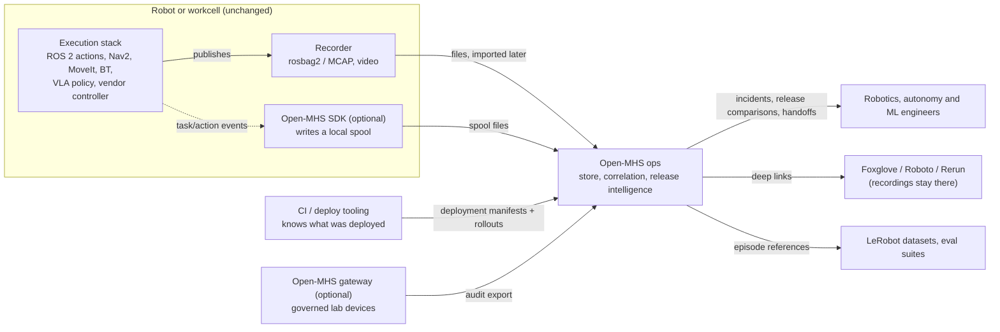
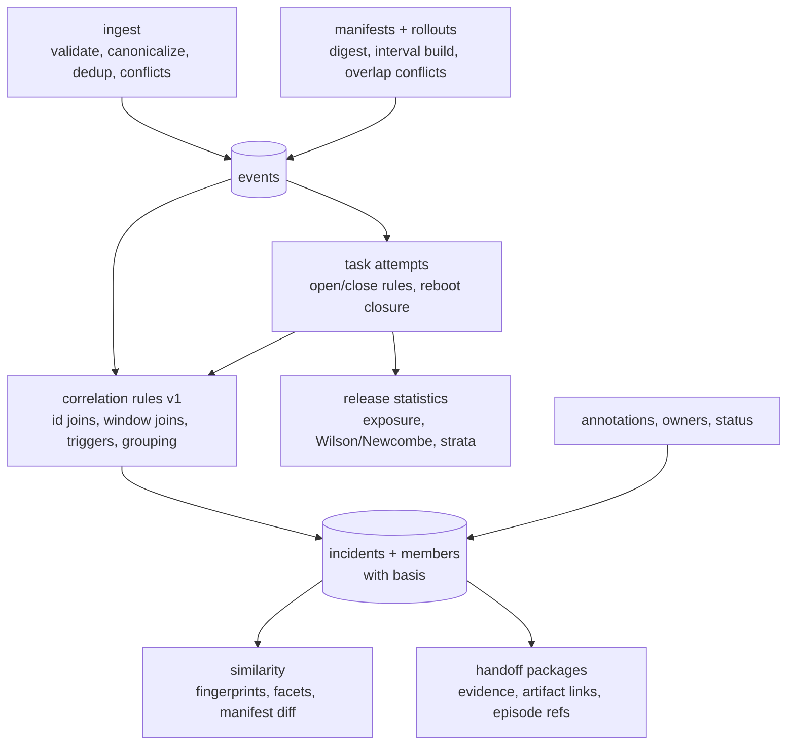
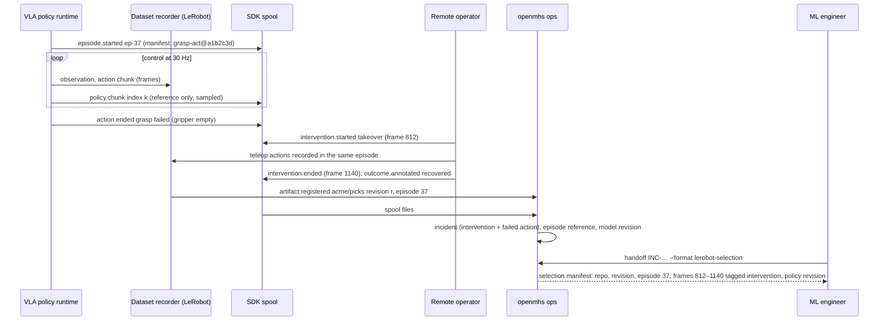
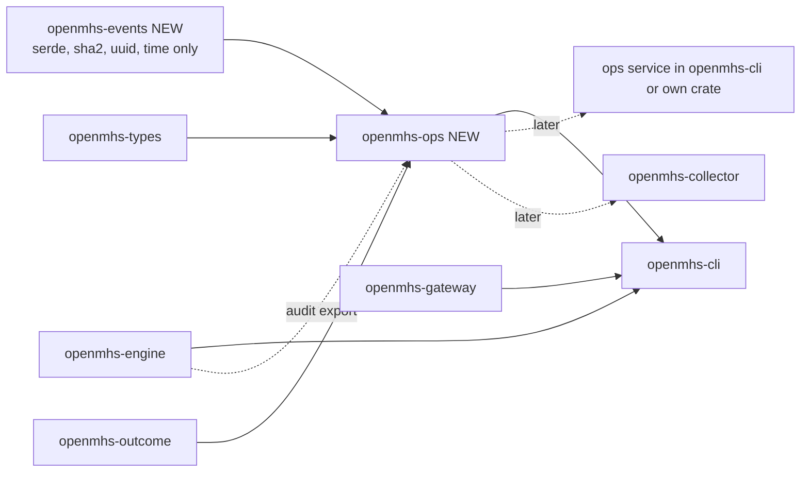

# C. System architecture

Decisions: ADR-0026 to ADR-0034. Data model: [RFC 0005](../../rfcs/0005-deployment-events.md). APIs:
[05-api.md](05-api.md). Scale and security: [06-scale-reliability-security.md](06-scale-reliability-security.md).

## 1. Context (C4 level 1)



Nothing points from Open-MHS ops into the robot. That is the architecture's first invariant (ADR-0026).

## 2. Containers (C4 level 2)

| Container | Stage | Technology | Responsibility |
|---|---|---|---|
| Importers | 1 | Python (`openmhs.importers`), `mcap-ros2-support` | Recording + manifest → envelope JSON Lines. Action status per goal, `/clock` placement, deployment files, operator CSV |
| SDK spool writer | 1 | Python `openmhs.ops`, later Rust | Task/action/intervention events → append-only local JSONL with rotation and a byte quota |
| `openmhs ops` CLI | 1 | Rust (`openmhs-cli` + `openmhs-ops`) | ingest, rebuild, incidents, timeline, compare, handoff, directly on the store |
| Ops store | 1 | SQLite `ops.sqlite` | Events (truth), manifests, rollouts, artifacts, derived tables, human state |
| Ops service | 1-2 | Rust, axum (already a dependency) | HTTP API (ADR-0031), web page, MCP read tools |
| Gateway exporter | 1 | Rust, reads the audit chain | Gateway commands and receipts → envelope |
| Collector | 2 (conditional) | Rust `openmhs-collector` | Live ingestion on the robot or site: spool, quota, upload with resume |
| Hosted ops | 2-3 | PostgreSQL, object storage, later a column store and queue | Multi-site, multi-tenant (ADR-0029 triggers) |

## 3. Components of `openmhs-ops` (C4 level 3)



Derived tables carry `rules_version`; `openmhs ops rebuild` replays all events through the current rules and keeps
human state attached by stable incident id (RFC 0005 §6).

## 4. The ten layers

### Layer 1: Edge collection (deferred, ADR-0027)

The first edge "agent" is a file: SDKs append envelopes to a spool directory (`$OPENMHS_SPOOL`, default
`/var/lib/openmhs/spool`), rotated at 16 MiB, bounded by a byte quota, oldest `info` events dropped first and every
drop counted in the next file's header. Importers and, later, the collector read the same files.

When the collector is justified it is a single Rust binary that:

- accepts envelopes on a Unix socket and loopback HTTP, and tails the spool;
- stores them in its own SQLite buffer (WAL, `synchronous=NORMAL`) with the journal's quota-and-reserve design
  (ADR-0021): `critical` events (task ends, faults, interventions, deployments) keep a reserve; `info` events are
  dropped first and counted;
- uploads batches of up to 1,000 events / 1 MiB to `POST /v1/events:batch`, marking events sent only on a per-event
  `accepted` or `duplicate` answer, so a crash between send and mark only causes duplicates, which ingestion ignores;
- never blocks a producer: a full socket buffer or a full disk returns immediately with a counted drop;
- budget: under 30 MiB RSS, under 1 % of one core at 50 events/s, under 100 MiB disk by default.

Reuse: `journal/segments.rs` sealing and `audit_class.rs` priority classes; nothing from the engine's command path.

### Layer 2: Integration SDKs

See [05-api.md](05-api.md) §2. Principles: never raise into robot code by default; context propagation by
`contextvars` (Python) and task-local values (Rust); one background writer thread; batching by count and time;
OpenTelemetry ids picked up when present; ROS helpers that observe action status topics rather than wrapping clients.

### Layer 3: Event and identity model

[RFC 0005](../../rfcs/0005-deployment-events.md).

### Layer 4: Storage and ingestion

ADR-0029 and RFC 0005 §6. Ingestion steps: parse → validate against schema version → canonicalize → hash → insert or
classify (`accepted`, `duplicate`, `conflict`, `rejected` with a reason) → enqueue affected robots/tasks for
derivation. Derivation is incremental per robot and time range, and must equal a full rebuild (property test).

### Layer 5: Incident correlation engine (rules v1)

Inputs: events and task attempts. Outputs: incidents with members and bases. All thresholds are configuration,
recorded in `rules_version`.

1. **Task assembly.** Group by (`tenant`, `robot`, `task_id`); `task.started`/`task.ended` bound the attempt. Actions
   join by `task_id` or by `part_of`. A task without an end is `open`; after `task_timeout` (default 30 min) or a
   reboot of its source it closes as `unknown` with the reason.
2. **Triggers.** An incident opens for a task attempt whose outcome is `failed`, `aborted`, `timeout` or `unknown`;
   whose `verified` outcome is `violated`; whose reported and verified outcomes disagree; or that contains an
   intervention. A fault of severity `error` or `critical` outside any task opens a robot-level incident.
3. **Membership.** Exact joins first (`task_id`, `goal_id`, `trace_id`, `episode_id`): basis `id_match`. Then window
   joins: faults, markers and status events on the same robot within [task start − 30 s, task end + 10 s], widened by
   the clock uncertainty of both sides: basis `window`, with the window recorded. An event inside two open incidents
   is a member of both, marked `ambiguous`.
4. **Grouping and duplicate suppression.** Incidents on one robot that overlap in time and share a fault code merge.
   A fingerprint (task type, component, first fault code, reported outcome) identifies recurrences; repeated
   fingerprints within `dedup_window` (default 10 min) on one robot become one incident with a count.
5. **Context.** Each incident gets the manifest in force, the **manifest diff since the last successful attempt of
   the same task type on the same robot**, interventions, artifacts overlapping its window, and links.
6. **Timeline.** Members sorted by RFC 0005 §5 ordering; events whose order is uncertain are shown as concurrent.
7. **Taxonomy.** `category` is the producer's code mapped through a user-editable table to a small starter set
   (`navigation.localization`, `navigation.planning`, `manipulation.grasp`, `perception`, `hardware`, `comms`,
   `safety_stop`, `operator`, `software.crash`, `unknown`). Unmapped codes stay `unmapped:<code>`.
8. **Similar incidents.** Same fingerprint first; then facet overlap (task type, category, component, site, manifest
   component that changed), each match explained.
9. **Ownership.** `owner`, `status` (`open`, `investigating`, `resolved`, `wont_fix`), annotations: human state.

Correlation is not causal inference (ADR-0030). The timeline says "the localization fault was raised 1.2 s before
the action aborted"; whether it caused the abort is an annotation.

### Layer 6: Deployment intelligence

Tracked: manifests (software, image digest, model/policy revision, config digest, firmware, hardware revision,
calibration ids) and rollouts per robot. Comparison: ADR-0032. Example query, "did the grasp failure rate rise after
policy v47?":

1. Select task attempts with `task_type = pick` that **started** under manifests whose `grasp-policy` component is v47,
   and those under the previous revision, over the chosen period.
2. Stratify by site (and by hardware revision if it differs between arms).
3. Per stratum: failures / attempts with Wilson intervals; unknowns shown as both bounds.
4. Pooled difference (CMH) with a Newcombe interval; `insufficient_evidence` rules (ADR-0032 §5).
5. Show the rollout timeline (which robots switched when), because a staggered rollout confounds time with release.
6. Link the incidents of each arm, newest first.

### Layer 7: Physical AI training feedback

Open-MHS holds the *context*; datasets hold the *data*.

- An `episode` (RFC 0005 §2) can map 1:1 to a LeRobot dataset v3 episode: `ext.lerobot = {repo_id, episode_index,
  revision}`; frame ranges in `evidence[].range` use the dataset's timestamps.
- Interventions carry start/end times and the episode reference, so a handoff can list "frames 812-1,140 of
  episode 37 were a human recovery". The exported selection is a small Parquet or JSON manifest that a LeRobot loader
  script can use to build a filtered dataset; Open-MHS does not write video or joint data.
- Policy lineage is the manifest's `model` component (immutable revision and checkpoint digest). Action chunks are
  `policy.chunk` events with index and horizon only.
- Outcome and reward signals are `outcome.*` fields and `evaluation.result` events, never inferred from logs.

### Layer 8: Evaluation and world-model readiness

| Capability | Today (in the schema) | Optional plugin later | Not until validated |
|---|---|---|---|
| Simulation and real evaluation runs | `evaluation.run`/`.result` with suite, task, seed, checkpoint, `source.kind = eval/sim` | Importers for Isaac Lab-Arena, LIBERO, ManiSkill result files | Running evaluations |
| Sim vs real comparison | Same task type and manifest across `sim` and real robots; compared like releases | Matched-scenario pairing | Claims of sim-to-real transfer |
| Policy regression | Release comparison (ADR-0032) with the policy component as the varying factor | Sequential monitoring with always-valid intervals | Automatic rollback |
| World-model prediction vs observation | `annotation` or `ext.worldmodel` records referencing a prediction artifact and the observed window | A comparison plugin computing error metrics over referenced trajectories | Any first-class "prediction" type: the representations are not stable |
| Planner failure analysis | Planner faults as `fault.*` with category | Planner-specific extractors | |

Stable concepts now: task, episode, action, intervention, outcome with provenance, manifest, artifact, evaluation run.
Unstable, kept in `ext` and plugins: action-chunk internals, latent states, world-model outputs, reward shaping.

### Layer 9: APIs and user experience

APIs: [05-api.md](05-api.md). Four experiences, first as CLI output and a single static page served by the ops
service, later as a web app only if partners use them.

**Incident explorer** (one incident):

```
INC-7f3a  robot-12  warehouse-east  pick-918 (pick)      reported: aborted   verified: —   OPEN  owner: —
deployment sha256:9f2c… release 2026.11.2   changed since last success (pick-911, 41 min earlier):
  grasp-policy  hf://acme/grasp-act@a1b2c3d  (was @9e8d7c6)
09:30:52.104  task.started            pick-918                                  id_match
09:31:01.880  fault.raised  warning   perception.depth_dropout  /camera/depth   window ±250 ms
09:31:05.233  action.ended  aborted   grasp-42 goal 5b1d…  result_code 103      id_match
09:31:06.9 ±0.5 s  intervention.started  takeover remote  op-3                 window
09:32:40.002  intervention.ended
09:32:41.115  task.ended    failed
evidence  run_0931.mcap 09:30:40–09:31:10 [Open in Foxglove]   episode acme/picks#37 frames 812–1140
similar   3 incidents with fingerprint pick/manipulation.grasp/aborted since 2026.11.2 (0 in 2026.11.1)
```

**Release intelligence** (two manifests, one task type; illustrative numbers, computed with ADR-0032's methods):

```
pick   2026.11.1 → 2026.11.2   period 2026-11-01..14
            attempts  failed  unknown   rate over known (95% CI)   interventions / robot-hour
11.1         1,204      31       4     2.6% (1.8–3.6)             0.21 (0.17–0.26)   412.5 h
11.2           388      19       9     5.0% (3.2–7.7)             0.44 (0.34–0.57)   138.6 h
difference  +2.4 pts (+0.4 to +5.2, Newcombe)   unknowns as success / as failure: +2.0 / +4.6 pts
strata      11.2 ran only at warehouse-east: compared within that site only, n too small → see verdict
verdict     margin exceeded on all data, but confounded with site; insufficient evidence within warehouse-east
```

**Failure clusters**: a table of fingerprints with counts by release, site and hardware revision, each row linking
to its incidents. **Engineering handoff**: a directory or ZIP with `incident.json`, `timeline.md`, manifests,
artifact links (never the artifacts), episode selections, annotations, and a `README` saying what is observed,
inferred and unknown.

### Layer 10: Security and operational reliability

[06-scale-reliability-security.md](06-scale-reliability-security.md).

## 5. Sequence diagrams

### Scenario A: ROS 2 incident

```mermaid
sequenceDiagram
  participant Disp as Task dispatcher (RMF / app)
  participant Nav as Nav2 action server
  participant Bag as rosbag2 (MCAP)
  participant SDK as SDK spool (optional)
  participant Imp as Importer
  participant Ops as openmhs ops
  participant Eng as Engineer
  Disp->>SDK: task.started pick-918 (task_type pick)
  Disp->>Nav: send_goal NavigateToPose (goal 5b1d…)
  Nav-->>Bag: /navigate_to_pose/_action/status ACCEPTED, EXECUTING
  Nav-->>Bag: /amcl_pose covariance grows, /diagnostics localization WARN
  Nav-->>Bag: status ABORTED (no stamp)
  Disp->>SDK: task.ended failed? (or nothing: dispatcher crashed)
  Note over Bag,Imp: later, files copied off the robot
  Imp->>Bag: read status, diagnostics, /clock
  Imp->>Ops: events (goal-keyed actions, faults), artifact reference
  SDK->>Ops: spool files (task events)
  Ops->>Ops: assemble task, join by goal id and window, open incident, attach manifest diff
  Eng->>Ops: incidents --robot robot-12 ; timeline INC-…
  Ops-->>Eng: timeline, evidence links, "outcome reported aborted; verified none; task end unknown (no task.ended)"
```

Failure modes: no `task.ended` (task closes `unknown` after the timeout rule, not `failed`); status with an empty
schema in the bag (importer's supplied definition, recorded); goal id absent from task events (window join, marked
inferred); clock domains differ between SDK and bag (uncertainty must be stated or ordering shows concurrency).
Guarantee: the same files imported twice produce the same incident.

### Scenario B: VLA policy failure and human takeover



Failure modes: frame indices and SDK times on different clocks (the selection carries both and the uncertainty);
dataset revision rewritten after export (the selection pins the revision; a missing revision is reported, not
silently re-resolved); operator forgets `intervention.ended` (closes at episode end, marked inferred).

### Scenario C: Deployment regression

```mermaid
sequenceDiagram
  participant CD as CI/CD
  participant Ops as openmhs ops
  participant Fleet as Robots (spools, recordings)
  participant Eng as Release owner
  CD->>Ops: POST /v1/deployments (manifest 11.2) ; deployment.applied per robot as rollout proceeds
  Fleet->>Ops: task attempts with outcomes (import or upload)
  Ops->>Ops: attribute attempts to manifests by start time (event or rollout interval)
  Eng->>Ops: compare --task pick --from 11.1 --to 11.2 --by site
  Ops-->>Eng: rates, intervals, unknown bounds, strata mix, insufficient_evidence or margin exceeded
  Ops-->>Eng: representative incidents per arm
```

Failure modes: robots that never reported `deployment.applied` (attempts attributed by interval only if the interval
is known; otherwise `excluded: no_manifest`, counted); rollouts by site (stratification shows the confound; the
verdict says so); late uploads after the comparison (comparisons are labelled with the data cut-off time and
re-runnable). Guarantee: deterministic for a given cut-off.

### Scenario D: Offline robot

```mermaid
sequenceDiagram
  participant App as Robot software + SDK
  participant Sp as Local spool / collector buffer
  participant Net as Network
  participant Ops as openmhs ops
  App->>Sp: events (append, fsync per batch)
  Net--xSp: link down for 6 h
  App->>Sp: keeps appending; quota reached → drop info events, count drops
  Note over App: robot keeps working; nothing waits on Open-MHS
  App->>Sp: reboot → new boot_id, seq restarts
  Net-->>Sp: link up
  Sp->>Ops: upload oldest first, batches with per-event results
  Ops-->>Sp: accepted / duplicate / conflict per event
  Sp->>Sp: mark sent; resend unmarked after crash (duplicates ignored)
  Ops->>Ops: rebuild robot's attempts for the affected window; open tasks of the old boot closed unknown
```

Failure modes: disk full before upload (counted drops, critical reserve kept); clock jump during outage (ordering
within a boot by `seq`, across boots by time with widened uncertainty); robot reassigned while offline (logical id
kept; hardware component in the manifest changes). Guarantee: at-least-once delivery, exactly-once *storage* per
event id; no ordering guarantee across sources beyond what clocks support.

## 6. Three horizons

| Horizon | Users | First capabilities | Schema elements already present |
|---|---|---|---|
| A. Production robot operations (now) | Deployment, infrastructure and autonomy engineers | Import, incidents, timelines, manifests, release comparison, handoff | Everything in RFC 0005 §2 except `policy.chunk`, `evaluation.*` |
| B. Learning and evaluation (next) | ML engineers | Episode references, intervention segments, policy lineage, eval runs, sim-vs-real comparisons | `episode.*`, `policy.chunk`, `evaluation.*`, model components |
| C. World models and fleet learning (later) | Research and platform teams | Plugins over referenced artifacts; fleet-wide regression monitoring | Only `ext` namespaces and artifact references. No first-class types until representations settle |

## 7. Crate dependency graph (proposed)



`openmhs-events` depends on nothing in the gateway domain, so third parties can emit events without pulling in the
engine.
