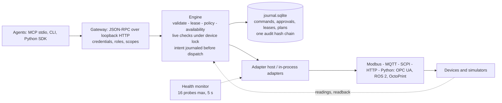
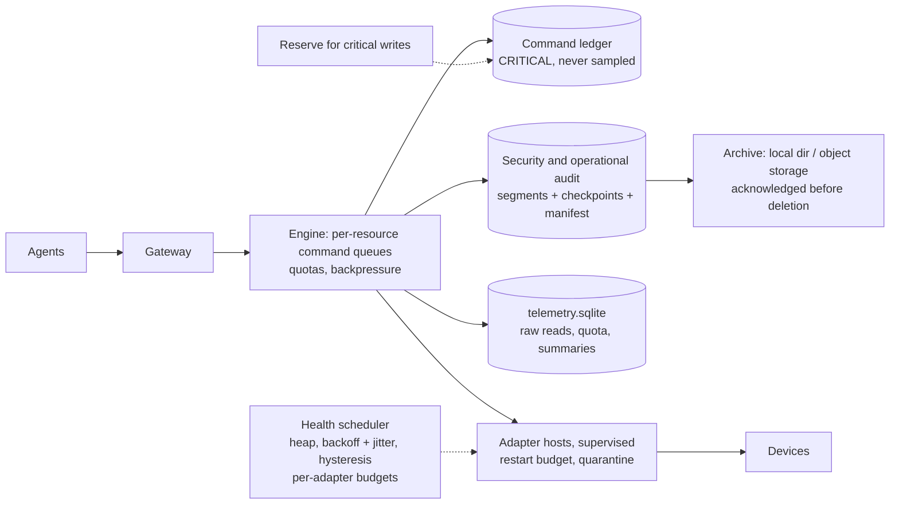

# Next milestone roadmap and decision memo

Replaces the placeholder "M11+ Advanced track" in [docs/roadmap.md](../roadmap.md) if
accepted. Based on [CURRENT_STATE_AUDIT.md](CURRENT_STATE_AUDIT.md) and
[ARCHITECTURE_GAP_ANALYSIS.md](ARCHITECTURE_GAP_ANALYSIS.md). Effort figures are rough
estimates of one engineer's focused time, not commitments.

## 1. Ranking

The brief's nine candidate workstreams, re-ordered after reading the repository. Scores are
1 (low) to 5 (high) and reflect judgment, not measurement.

| Rank | Milestone | Adoption leverage | Feasibility | Technical importance | Research value | Why here |
|---|---|---|---|---|---|---|
| 1 | **M11 Release readiness and green CI** (was M11) | 5 | 5 | 3 | 1 | Nothing else matters until a stranger can install it and `main` is green |
| 2 | **M12 First physical validation** (was M18) | 5 | 3 | 4 | 4 | "No hardware tested" is the largest credibility gap, and the ESP32 path is nearly built |
| 3 | **M13 Storage safety and audit lifecycle** (new) | 2 | 3 | 5 | 3 | Unbounded journal growth is a correctness-over-time problem for any real deployment |
| 4 | **M14 Fleet health and execution scaling** (new; extends ADR-0019) | 2 | 3 | 5 | 3 | Readback freshness (H4) and the unknown-outcome hold are the safety core |
| 5 | **M15 HardwareBench** (was M15) | 3 | 3 | 3 | 5 | The most defensible research contribution; needs M14's fixes to be interesting |
| 6 | **M16 Third-party adapters and registry** (was M12) | 5 | 3 | 3 | 2 | Needs a release (M11) and publishable crates; the ecosystem premise |
| 7 | **M17 Agent discovery v2** (was M13) | 4 | 4 | 3 | 2 | `capabilities.allowed`, tool projection, MCP over HTTP |
| 8 | **M18 Playground** (was M14) | 4 | 4 | 2 | 2 | A first slice ships in M11; the rest follows adoption |
| 9 | **M19 ROS 2 / OPC UA / SiLA bridges** (was M16) | 3 | 2 | 3 | 3 | Valuable only with a user who has the system; do not build speculatively |
| 10 | **M20 Multi-device workflows v2, federation** (was M17) | 2 | 2 | 3 | 3 | Plans exist; parallel steps and fleets wait for real multi-site users |
| — | Community governance (was M19) | — | — | — | — | Not a milestone: runs continuously from M11 (second maintainer, issues, discussions) |

## 2. Milestones

### M11 — Release readiness and green CI

- **Objective.** A stranger installs OpenMHS without a Rust toolchain and gets to a
  refused-then-verified command in under 15 minutes. `main` is green on three platforms.
- **Architecture.** No change. Uses the existing `cargo-dist` and PyPI workflows.
- **Existing modules reused.** `dist-workspace.toml`, `.github/workflows/{release,pypi,docs}.yml`,
  `openmhs demo`.
- **New work.** Merge the SCPI fix and availability work (this branch). Make macOS a
  non-blocking job. Lean build profile (done on this branch). Owner actions from
  `docs/release/M10_TEST_REPORT.md`. Draft release; test Linux and macOS archives from a
  clean machine. `openmhs playground` first slice (§M18). File the ten good-first issues,
  enable Discussions. Unblock crates.io (`openmhs-types` embeds `spec/` with `include_str!`).
- **Dependencies.** Owner access to repository settings, PyPI and Pages.
- **Acceptance.** CI green on `main` for Linux and Windows (macOS best-effort); a draft
  release whose Linux, macOS and Windows archives each run `openmhs demo`; a non-author
  completes the quickstart from the release in under 15 minutes (timed).
- **Automated tests.** Existing CI; a release-smoke job that downloads the archive and runs
  the demo.
- **External validation.** One person who did not write it, on a machine that never had Rust.
- **Documentation.** Installation page tested on Linux and macOS; CHANGELOG cut to 0.1.0.
- **Risks.** macOS runner availability; PyPI name taken; crates.io packaging more work than
  expected.
- **Effort.** 1–2 weeks.
- **User benefit.** Everything downstream depends on it.

### M12 — First physical validation (ESP32, then a bench supply)

- **Objective.** One physically validated row in the compatibility matrix, with an evidence
  bundle, published including every failure.
- **Architecture.** None. Same adapter, a real device.
- **Reused.** `firmware/esp32-mqtt-node`, MQTT profile, its 18-test harness, `openmhs
  conformance`, registry `peer: device`.
- **New work.** Run [HARDWARE_VALIDATION_PLAN.md](HARDWARE_VALIDATION_PLAN.md) §4 on an ESP32
  over real Wi-Fi with a multimeter and logic analyzer; add the `hardware_report` field to the
  registry schema and matrix generator; then the SCPI bench supply with an independent DMM.
- **Dependencies.** The hardware and a person to supervise (the maintainer).
- **Acceptance.** All of §4 run 20× where specified; every case matches on both the OpenMHS
  and physical columns, or the divergence is reported as a finding; evidence bundle
  committed; second-person reproduction of at least the C1 and T3 cases.
- **Automated tests.** The bundle's `cases.csv` is validated by a script; the ESP32 node
  tests continue to run in QEMU.
- **External validation.** This milestone *is* external validation.
- **Risks.** Real Wi-Fi exposes timing differences QEMU hid; the PSU adapter needs readback
  freshness (H4) fixed first to be a fair test of T3.
- **Effort.** 2–3 weeks for the ESP32; 3–4 for the supply.
- **User benefit.** Turns "simulated only" into a claim with evidence.

### M13 — Storage safety and audit lifecycle

- **Objective.** Bounded storage with no loss of required evidence, as specified in
  [STORAGE_AND_SCALING_RFC.md](STORAGE_AND_SCALING_RFC.md) after review.
- **Architecture.** Event classes; `telemetry.sqlite`; audit segments with checkpoints and a
  manifest; critical-write reserve; storage metrics in `gateway.info`.
- **APIs.** `gateway.info` gains journal size, record counts, quota state; `audit.verify`
  gains `--all` and checkpoint start; new `audit.archive` (operator) and `audit.holds`.
- **Reused.** `Journal`, hash chain, Ed25519 from M8.
- **New work.** Class declared per audit kind with a test that fails on an unclassified
  kind; migration closing the existing chain as segment 0; archive acknowledgement before
  deletion; reserve file; read summaries.
- **Dependencies.** RFC review; decisions on its four questions.
- **Acceptance.** 24-hour simulated run with bounded growth; kill the gateway during
  rotation and during archival, restart, verify the chain; fill the disk and observe: writes
  refused, a stop still recorded, nothing re-sent after restart.
- **Automated tests.** Fault-injected storage tests (SQLITE_FULL, partial segment write,
  interrupted archive); verification detects a deleted record, a replaced record and a
  missing archive.
- **External validation.** Review of the integrity argument by someone who did not write it.
- **Risks.** Touches audit integrity: highest-risk change in the roadmap; mitigated by
  never deleting before archive acknowledgement and by the migration deleting nothing.
- **Effort.** 4–6 weeks.
- **User benefit.** A gateway that can run for a year.

### M14 — Fleet health and execution scaling

- **Objective.** Predictable behavior at hundreds to thousands of devices, and the safety
  gaps H4–H6 closed.
- **Architecture.** Per-device probe schedule (heap), backoff with jitter, per-adapter
  budgets, hysteresis, `RECOVERING`; concurrent device registration at start; readback must
  be newer than dispatch; adapters are not aborted mid-write; unresolved hold across related
  capabilities; bounded command queues with per-agent quotas and a `resource.exhausted`
  response.
- **Reused.** ADR-0019 availability; device lock; `holds_with` via the graph's
  `shares_resource`.
- **New work.** As listed; RFC for H4 (it tightens a safety rule); conformance checks
  `L2.stale_readback` and `L2.cancel_mid_write`.
- **Acceptance.** Benchmarks at 10 / 100 / 1,000 / 10,000 simulated devices with measured
  CPU, memory, storage per day, p50/p95/p99 command latency, sweep lag and restart
  recovery time (no numbers assumed beforehand); startup with 1,000 hanging devices bounded;
  no duplicate dispatch after restart.
- **Risks.** H4 breaks adapters that serve cached readings; they will fail the new check,
  which is the point and must be announced.
- **Effort.** 5–8 weeks.
- **User benefit.** Trust at scale and at the unusual moments.

### M15 — HardwareBench

[HARDWAREBENCH_RESEARCH_PLAN.md](HARDWAREBENCH_RESEARCH_PLAN.md) steps 1–4. **Acceptance:**
S01–S16 runnable with `openmhs bench`, baselines B0–B2, OpenMHS fails S03 and S06 before M14
and passes after (a real before/after), two other implementations scored with their
maintainers informed. **Effort:** 4–6 weeks. **Risk:** others do not expose enough to be
scored.

### M16 — Third-party adapters and registry

- **Objective.** One adapter maintained outside this repository, from published packages,
  listed with a conformance report.
- **New work.** Publish `openmhs-types`, `openmhs-adapter`, `openmhs-conformance`; PyPI
  `openmhs`; an out-of-tree example repository; registry schema (`devices`, firmware,
  multiple reports, `maintenance`); CODEOWNERS for `adapters/` and `registry/`; an OS
  sandbox plan for adapter processes (gap S2) before community adapters are enabled by
  default.
- **Acceptance.** A contributor who is not the maintainer lands an adapter listing via pull
  request following only the docs.
- **Effort.** 3–4 weeks plus waiting for the contributor.

### M17 — Agent discovery v2

[PHYSICAL_TOOL_RUNTIME_V2.md](PHYSICAL_TOOL_RUNTIME_V2.md) §2–§5: `capabilities.allowed`
(scopes ∩ grants), optional tool projection, `devices.watch`, MCP over Streamable HTTP with
change notifications (needs transport security first), lease queueing. **Effort:** 4–5
weeks.

### M18 — Playground

[PLAYGROUND_DESIGN.md](PLAYGROUND_DESIGN.md): `openmhs playground`, scenario scripts that
double as tests, `commands show --timeline`, `sim reset`, connector interface, independent
second peers (PyVISA-sim, pymodbus). First slice in M11. **Effort:** 2 weeks for the first
slice, 3 more for the rest.

### M19 — ROS 2 / OPC UA / SiLA 2 bridges

Only against a system a user actually has. ROS 2 supervisory actions → `invoke`
(`ACCEPTED`/`APPLIED`/readback); OPC UA writes and methods through the descriptor; SiLA 2
bridge for lab devices. Never inside a control loop. **Effort:** 3–6 weeks each, with the
user's system as the test.

### M20 — Workflows v2 and federation

Parallel plan steps where the graph shows no shared resource; standing approvals; device
hold. Federation (central metadata, signed policy distribution, fencing) only after three
independent sites run single gateways. **Effort:** open.

## 3. Technical-debt inventory

| Item | Where | Cost of leaving it |
|---|---|---|
| Unbounded journal growth | `Journal`, `Engine::read` | Storage and `audit verify` time (M13) |
| Readback accepts any GOOD reading | `engine.rs` `verify`, `reconcile` | Possible false `RECONCILED_NOT_APPLIED` and duplicate effect (M14) |
| `execute` aborted on timeout | `engine.rs` `dispatch` | Half-written frames on adapters that do not protect themselves (M14) |
| Sequential device registration at start | `openmhs-gateway` `start` | Startup time grows with devices x probe timeout (M14) |
| Unhysteresised probes | `availability.rs` | Flapping devices write many records (M14) |
| Rate history in memory | `Device.history` | Rate limits reset on restart |
| Stop needs a writable journal | `dispatch` | No stop on a full disk (M13 reserve) |
| `openmhs-types` cannot be published | `include_str!` of `spec/` | Blocks third-party adapters from depending on a version |
| Full workspace tests ≈ 10 minutes cold | CI | Contributors skip them |
| No OS sandbox for adapters | `openmhs-host` | Blocks safe community adapters |
| MCP stdio only | `openmhs-mcp` | No push, no remote agents |
| Mermaid diagrams render as source in the docs site | `docs/book` | Documentation polish |
| OPC UA and ROS 2 have no committed conformance reports | `conformance/reports` | Matrix shows them as unverified |
| Hand-written Python models mirror Rust types | `python/openmhs/models.py` | Drift; the parity test catches some |

## 4. Prioritized plan

**Next 30 days:** M11 complete; ESP32 hardware ordered and validation started (M12); RFC
review and the four open decisions answered; H4 written up as an RFC; benchmark harness
skeleton so M13/M14 numbers come from measurement.

**Next 90 days:** M12 done for the ESP32 with a published bundle; M13 implemented
behind review (classification, metrics, reserve, segments); first half of M14 (concurrent
registration, readback freshness, no mid-write abort); first outside issue and pull request
handled.

**Next 180 days:** M14 complete with measured capacity model; M15 first results; M16 with
one outside adapter; bench-supply validation; second maintainer recruited; decide whether
the research or the adapter-ecosystem path is carrying the project.

## 5. Architecture diagrams

### Current (what the code does)

### Proposed (milestones M13-M14, not built)

## 6. Competitive positioning (summary)

Full table in [ADOPTION_AND_SUSTAINABILITY.md](ADOPTION_AND_SUSTAINABILITY.md) §2. In one
sentence: *a supervisory layer with an honest model of uncertain physical outcomes,
complementary to ROS 2, OPC UA and SiLA 2, unlike simulated-only MCP hardware servers that
stop at "allowed or blocked"; unvalidated on hardware, with one maintainer, and not
compatible with any unpublished standard.*

## 7. Community contributor roadmap

Staged in [OPEN_SOURCE_ECOSYSTEM_PLAN.md](OPEN_SOURCE_ECOSYSTEM_PLAN.md) §5: first visit →
first contribution → adapter author → hardware validator → adapter reviewer → maintainer.

---

# Final decision memo

**1. What makes OpenMHS genuinely different from an ordinary MCP hardware server?**
It treats an uncertain physical outcome as a state with rules. A timed-out write is
`UNKNOWN_OUTCOME`, is never resent, blocks a new non-idempotent write to that capability
(`command.outcome_unresolved`) until readback reconciliation or a person resolves it, and
leaves an auditable record. Intent is journaled before the device is touched, so a crash
mid-command is recovered conservatively. Around that: deny-by-default policy independent of
the model, approvals bound to a command fingerprint, units and limits in a written contract,
and a conformance suite any adapter can be tested with. Not different: it is not first, not
a standard, and not validated on hardware.

**2. Which existing capabilities are strong enough to build upon?**
The command lifecycle and journal; the adapter contract (small, with error classes that say
whether the device might have acted); policy and credentials; leases and plans; the
conformance suite with negative controls; the profile adapters for four protocols; the
registry's evidence-based design; the documentation discipline (limitations stated plainly).

**3. What should we stop building because established projects solve it?**
Real-time control (ros2_control and device controllers). A VISA stack (PyVISA). Information
models (OPC UA companion specs, SiLA 2 features). Hosted multi-tenant simulator platforms.
Message brokers for the fleet case before a second site exists. Hand-written duplicates of
generated types where a schema can generate them.

**4. Which five improvements would most increase actual developer adoption?**
(1) A release with binaries and a PyPI package. (2) Green CI on all platforms. (3) A
one-command playground ending in a visible refusal and a visible recovery. (4) A published
physical validation with evidence, even a small one. (5) One outside adapter and a short,
honest "connect your instrument" story with two or three popular instruments pre-profiled.

**5. How do we make OpenMHS attractive to robotics labs, research institutions and
manufacturers?**
Labs: a bounded pilot on one instrument with a supervising person, a written scope and a
report at the end; bridges to what they already run (ROS 2 actions, OPC UA, SiLA 2) rather
than replacements. Institutions: HardwareBench with reproducible scenarios and public
results, including OpenMHS's own failures. Manufacturers: only after labs ask; offer the
conformance suite and a registry listing as a way to show their device works with agents,
never certification.

**6. How could OpenMHS develop an independently maintained adapter ecosystem?**
Make adding a device a profile or a one-file Python adapter, publish the SDKs, ship an
out-of-tree example, list adapters in a Git registry by evidence (simulated, integration,
physically validated), give adapter maintainers ownership of their entries and reviewers
from among them, and sandbox adapter processes before enabling community adapters by
default. The first outside adapter is the proof; until then, the ecosystem is a design.

**7. What is the strongest research contribution we could realistically pursue?**
A reproducible measurement of duplicate-effect and false-success rates under lost
acknowledgments and restarts, comparing retry-on-timeout, fail-on-timeout and explicit
`UNKNOWN_OUTCOME` with reconciliation (RQ2 in the HardwareBench plan), using ground-truth
delivery counters in simulators and, for at least one device, physical confirmation. It
turns a design claim into a measurement and is cheap to start.

**8. What is the most promising long-term commercial opportunity, and what evidence is
missing?**
Supported deployments plus compatibility testing for laboratories and integrators where an
agent repeating a physical action is expensive. Missing: any customer conversation, any
pilot, any statement of what someone would pay, any physical validation, process sandboxing,
signed audit export, and fleet tooling. Treat commercial work as unproven until a pilot lab
asks for something the open-source project does not give for free.

**9. What should the team build over the next 30, 90 and 180 days?**
See §4. In one line each: 30: release and green CI; 90: first physical validation and
storage safety; 180: scaling and safety fixes with measurements, HardwareBench results and
one outside adapter.

**10. What single improvement should we implement right now?**
Done on this branch: **device availability**, plus the SCPI CI fix and a lean build
profile. A gateway no longer fails to start, and recovery no longer waits, because one
instrument is off; commands to an offline device are refused before anything is sent; and
agents, operators and SDK users can see why. It is bounded, verified (see the audit's test
results), and prepares M13 and M14 without changing any security boundary: a stop still
needs authorization and still skips only the availability gate.
