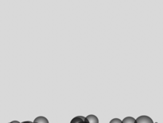
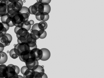
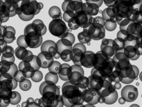
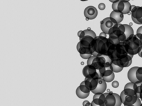
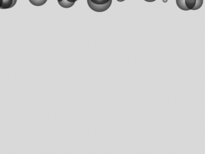

# Simulated sample survey: workflow report

Run 2026-10-30T18:30:57+0530 to 2026-10-30T18:31:54+0530. **Simulator only; no hardware was accessed.**

## 1. Discovery

- Things on the server: autofocus, bg_channel_deviations_luv, bg_color_channels_luv, camera, camera_stage_mapping, gallery, histo_scan_workflow, illumination, raster_workflow, smart_scan, snake_workflow, stage, system, timelapse
- Stage capabilities imported: axis_inverted.x, axis_inverted.y, axis_inverted.z, backlash_steps.x, backlash_steps.y, backlash_steps.z, calibration_required, can_calibrate, move_x, move_y, move_z, moving, position.x, position.y, position.z
- Numeric fields with a declared unit: 0 of 7 (none)
- Start position (OpenMHS readback): {'x': 0, 'y': 0, 'z': 0}

## 2. Approved procedure

raster survey, serpentine, 25 points, envelope {'x': 1200, 'y': 1200, 'z': 400} (simulator steps), procedure sha256 `ff3e3df96e31ca1b`.

## 3. Survey and deterministic analysis

Method: threshold = 95th-percentile background - 40; opening; connected components (>= 6 px at 1/4 scale); Laplacian variance for sharpness. Background level 218.0.

| image | x | y | sample fraction | features | sharpness |
|---|---|---|---|---|---|
|  `img-s00` | -1000 | -1000 | 0.0 | 0 | 2.33 |
|  `img-s01` | -500 | -1000 | 0.0 | 0 | 1.0 |
|  `img-s02` | 0 | -1000 | 0.0 | 0 | 1.24 |
|  `img-s03` | 500 | -1000 | 0.0 | 0 | 1.52 |
|  `img-s04` | 1000 | -1000 | 0.0 | 0 | 1.19 |
|  `img-s05` | 1000 | -500 | 0.0 | 0 | 1.94 |
|  `img-s06` | 500 | -500 | 0.0133 | 2 | 3.56 |
|  `img-s07` | 0 | -500 | 0.0264 | 4 | 4.64 |
|  `img-s08` | -500 | -500 | 0.0102 | 2 | 3.43 |
|  `img-s09` | -1000 | -500 | 0.0 | 0 | 0.89 |
|  `img-s10` | -1000 | 0 | 0.0 | 0 | 1.71 |
|  `img-s11` | -500 | 0 | 0.3732 | 2 | 30.63 |
|  `img-s12` | 0 | 0 | 0.8179 | 5 | 71.08 |
|  `img-s13` | 500 | 0 | 0.3374 | 5 | 30.14 |
|  `img-s14` | 1000 | 0 | 0.0 | 0 | 0.79 |
|  `img-s15` | 1000 | 500 | 0.0 | 0 | 1.74 |
|  `img-s16` | 500 | 500 | 0.0008 | 1 | 1.61 |
|  `img-s17` | 0 | 500 | 0.0268 | 7 | 5.29 |
|  `img-s18` | -500 | 500 | 0.0087 | 1 | 2.39 |
|  `img-s19` | -1000 | 500 | 0.0 | 0 | 1.14 |
|  `img-s20` | -1000 | 1000 | 0.0 | 0 | 2.18 |
|  `img-s21` | -500 | 1000 | 0.0 | 0 | 0.89 |
|  `img-s22` | 0 | 1000 | 0.0 | 0 | 2.06 |
|  `img-s23` | 500 | 1000 | 0.0 | 0 | 1.57 |
|  `img-s24` | 1000 | 1000 | 0.0 | 0 | 1.05 |

Deterministic top three: img-s12, img-s11, img-s13.

## 4. Model proposal and validation

Model: gpt-6-luna; usage {'input_tokens': 1900, 'output_tokens': 226, 'estimated_cost_usd': 0.000303}.

```json
{
 "rois": [
  {
   "image_id": "img-s12",
   "reason": "Highest sample fraction (0.8179), 5 features, and highest sharpness (71.08)."
  },
  {
   "image_id": "img-s11",
   "reason": "Substantial sample fraction (0.3732), sharpness (30.63), and contrast (76.56)."
  },
  {
   "image_id": "img-s13",
   "reason": "Substantial sample fraction (0.3374), 5 features, and contrast (73.25)."
  }
 ],
 "points": [
  {
   "x": 0,
   "y": 250,
   "near_image_id": "img-s12"
  },
  {
   "x": 250,
   "y": 0,
   "near_image_id": "img-s12"
  },
  {
   "x": -250,
   "y": 0,
   "near_image_id": "img-s12"
  },
  {
   "x": 0,
   "y": -250,
   "near_image_id": "img-s12"
  }
 ],
 "refocus_image_id": "img-s12",
 "explanation": "Prioritize the three positions with the largest sample fractions and strongest focus/contrast measurements; refocus the strongest position before nearby sampling."
}
```

- Accepted follow-up points: [{'x': 0, 'y': 250, 'near_image_id': 'img-s12'}, {'x': 250, 'y': 0, 'near_image_id': 'img-s12'}, {'x': -250, 'y': 0, 'near_image_id': 'img-s12'}, {'x': 0, 'y': -250, 'near_image_id': 'img-s12'}]
- Rejected: none
- Numbers cited for ROIs checked against the table: 9, unsupported: none
- Fabrication flags: none
- Refocus target accepted: img-s12

## 5. Adaptation

Focus sweep at img-s12: z=-300 sharpness 3.13, z=-150 sharpness 4.2, z=0 sharpness 71.19, z=150 sharpness 4.65, z=300 sharpness 2.88. Best z = 0.

Follow-up captures: [('img-a0', 0, 250, 11), ('img-a1', 250, 0, 5), ('img-a2', -250, 0, 5), ('img-a3', 0, -250, 4)]. Each follow-up move was held for approval; approvals: 15.

## 6. Fault and reconciliation

- `x=0` (survey point 12): suspended at 2026-10-30T18:31:15+0530, RECONCILED_APPLIED at 2026-10-30T18:31:18+0530; device reference `labthings:149e46a8-f2c9-4517-9c69-4f8da1f2875f`.
- Simulator executions of each faulted move: [1] (1 means it was not repeated).
- Moves executed by the simulator: 41; recorded by OpenMHS: 41; executions with no OpenMHS reference: 0.
- Final position {'x': 0, 'y': 0, 'z': 0} vs start {'x': 0, 'y': 0, 'z': 0}.

## 7. Audit integrity

- Chain valid: True (376 records); offline `audit verify-file` exit 0 (0 = valid and complete).
- Receipts inconsistent with chain: none

## 8. Versions

`{"openmhs_commit": "db950d7", "openflexure_microscope_server": "3.0.0b1 (simulation config)", "labthings_fastapi": "0.3.0", "python": "3.13.4", "os": "Windows-11-10.0.26300-SP0"}`

## 9. Uncertainties

- Simulator only: images are synthetic and stage motion is a dummy stage; nothing here is physical evidence.
- Stage quantities declare no unit; all positions are simulator steps.
- Image capture is a camera read performed by the workflow, linked by time and position to OpenMHS-verified moves; OpenMHS does not itself attest the image content.
- RECONCILED_APPLIED means a readback after the fault matched the target; it does not prove when the move finished.
- No action remained unresolved.
- Analysis thresholds are fixed choices for this simulator, not validated for real samples.

Images: thumbnails in `images/`; full frames were kept outside the repository with their sha256 listed in `workflow-report.json`.
